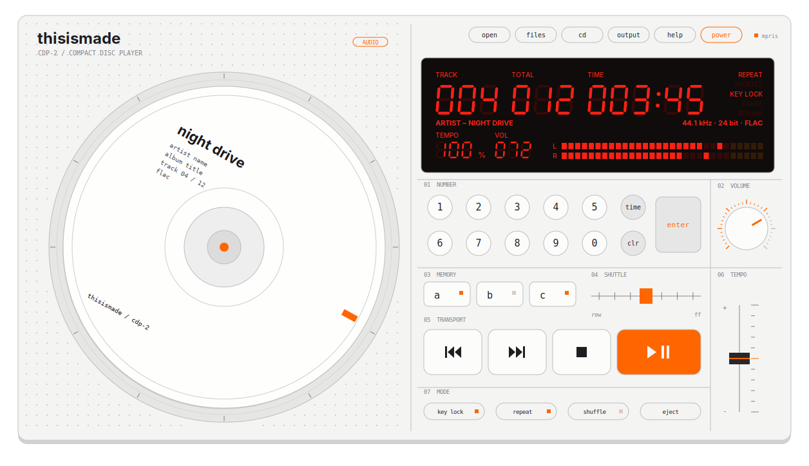

# thisismade cdp-2



Ein Musikplayer für **Windows 11**, **macOS** und **Ubuntu/GNOME**, der wie ein professionelles CD-Deck funktioniert:
drehende Disc zum Scratchen, rotes LED-Display mit Pegelanzeige, Tempo-Fader mit Key Lock,
drei Memory-Cues, Shuttle-Suchlauf, Ziffernblock für die direkte Titelwahl, Wiederholen und Zufall.

## Installieren

Unter [**Releases**](../../releases/latest) liegen fertige Pakete:

| Paket | So installierst du es |
|---|---|
| `thisismade-cdp-2_*_all.deb` | doppelt anklicken (App-Zentrum) oder `sudo apt install ./thisismade-cdp-2_*_all.deb` |
| `thisismade-cdp-2_*.snap` (nur Wayland, kein X11) | `sudo snap install --dangerous ./thisismade-cdp-2_*.snap` |

Oder alles mit einem Befehl – lädt die neueste Version und installiert sie samt Abhängigkeiten:

```bash
wget -qO- https://raw.githubusercontent.com/zc7ryr6ms4-eng/thisismade-CDP-2/main/install.sh | bash
```

Danach: **thisismade cdp-2** in der GNOME-Übersicht, oder `thisismade-cdp-2 ~/Musik` im Terminal.
Entfernen: `sudo apt remove thisismade-cdp-2` bzw. `sudo snap remove thisismade-cdp-2`.

### Windows 11 (und Windows 10)

`thisismade-cdp-2-Setup-1.0.0.exe` aus dem [neuesten Release](../../releases/latest) herunterladen und
starten – der Installer legt den Player im Startmenü an (optional auf dem Desktop) und trägt ihn unter
„Öffnen mit“ für Audiodateien und im Ordner-Kontextmenü ein. Kein .NET nötig, alles ist enthalten.
Weil das Setup nicht kostenpflichtig signiert ist, zeigt Windows SmartScreen beim ersten Start
„Der Computer wurde durch Windows geschützt“ → **Weitere Informationen** → **Trotzdem ausführen**.
Ohne Installation: `thisismade-cdp-2-portable-win-x64.zip` entpacken und die .exe starten.

### macOS (13 Ventura und neuer, Apple Silicon + Intel)

`thisismade-cdp-2-1.0.0.pkg` aus dem Release doppelklicken (fertig kompiliert) – oder:

```bash
curl -fsSL https://raw.githubusercontent.com/zc7ryr6ms4-eng/thisismade-CDP-2/main/install-mac.sh | bash
```

Lädt die App, legt sie in **Programme** und startet sie. Alternativ `thisismade-cdp-2.dmg` aus dem
Release öffnen und die App nach „Programme“ ziehen (beim ersten Start: Systemeinstellungen →
Datenschutz & Sicherheit → „Dennoch öffnen“, da die App nicht notarisiert ist).
Selbst bauen auf dem Mac: `xcode-select --install`, dann `bash macos/build.sh --install`.

Die Mac-Version ist eine native Swift-App (AppKit + AVFoundation): Tempo und Key Lock laufen
über AVAudioEngine ohne Aussetzer, Medientasten und Kontrollzentrum funktionieren, Audio-CDs
werden über das CD-Laufwerk in /Volumes gelesen.

## Funktionen

- **Laden:** OPEN (Ordner inkl. Unterordner), FILES (Dateien, .m3u-Playlists), CD (Audio-CD), Drag & Drop
- **Laufwerk:** Play/Pause, Stop, Titel vor/zurück, Klick auf die Disc = Play/Pause, Disc drehen = scratchen
- **Tempo:** 50–150 %; **Key Lock** aus = Tempo + Tonhöhe (Varispeed), an = nur Tempo (Time Stretch)
- **Memory A/B/C:** Merkpunkte setzen, anspringen, löschen – pro Titel gespeichert
- **Shuttle:** Rück-/Vorlauf bis 16-fach
- **Ziffernblock:** Titelnummer + ENTER, TIME (Restzeit), CLR
- **Display:** Titel, Anzahl, Zeit, Tempo, Lautstärke, Pegel L/R, Statusanzeigen
- **GNOME:** Medientasten, Sperrbildschirm und Mediensteuerung (MPRIS), kein Ruhezustand während der Wiedergabe
- Lückenlose Wiedergabe, Cover-Art auf der Disc, setzt beim nächsten Start an der letzten Stelle fort

Alle Tastenkürzel: im Player **F1** oder **HELP**.

Formate: alles, was GStreamer abspielt – MP3, FLAC, OGG, Opus, WAV, AIFF, M4A/AAC, WMA, APE, WavPack u. a.

## Aus dem Quellcode

```bash
sudo apt install python3-gi python3-gi-cairo gir1.2-gtk-4.0 gir1.2-gstreamer-1.0 \
     gstreamer1.0-plugins-good gstreamer1.0-plugins-bad gstreamer1.0-libav
python3 -m tmplayer ~/Musik        # direkt starten
bash build-deb.sh                  # .deb nach dist/ bauen
```

Jeder Push wird auf GitHub Actions mit echtem GTK4 und GStreamer getestet
(Abspielen, Tempo, Cue, Screenshot); ein Tag `v*` baut .deb und Snap und veröffentlicht ein Release.

## Snap Store

Das Snap wird automatisch im Ubuntu Snap Store veröffentlicht, sobald der Zugang eingerichtet ist – siehe [SNAP-STORE.md](SNAP-STORE.md).

## Ältere Version

Version 1 („Thisismade CD Player“) mit Linux-, macOS- und Windows-11-Fassung liegt als Archiv unter
[thisismade-CDP-1](https://github.com/zc7ryr6ms4-eng/thisismade-CDP-1).

## Projektaufbau

* `tmplayer/` – Linux-Version (Python, GTK4, GStreamer)
* `macos/` – macOS-Version (Swift, AppKit, AVFoundation), `macos/build.sh`
* `windows/` – Windows-Version (C#/.NET 8, WinForms, NAudio), `windows/installer.iss`
* `snap/`, `build-deb.sh` – Pakete für Ubuntu
* `install.sh`, `install-mac.sh` – Ein-Befehl-Installer

Lizenz: BSD 3-Clause (siehe LICENSE)
